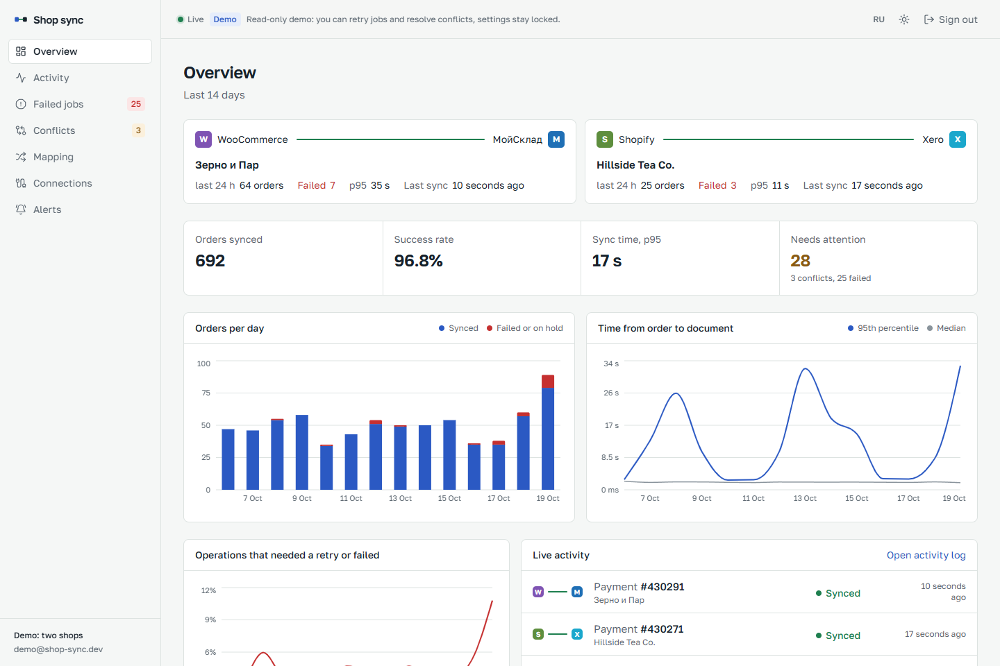
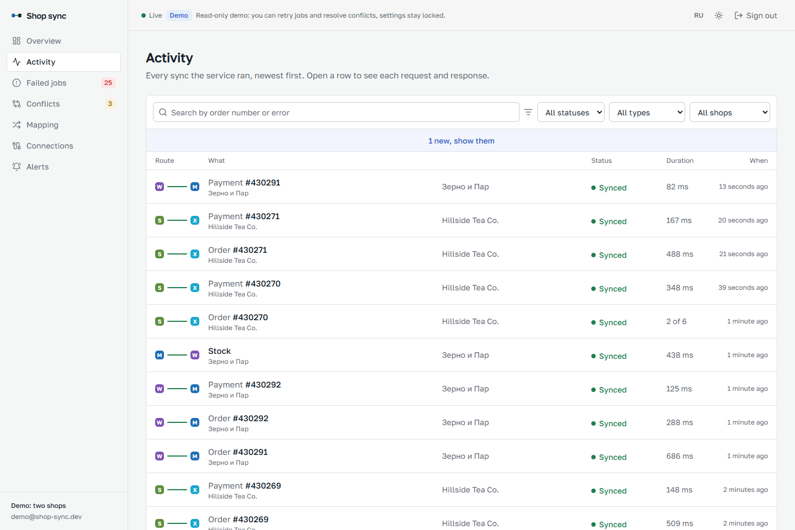
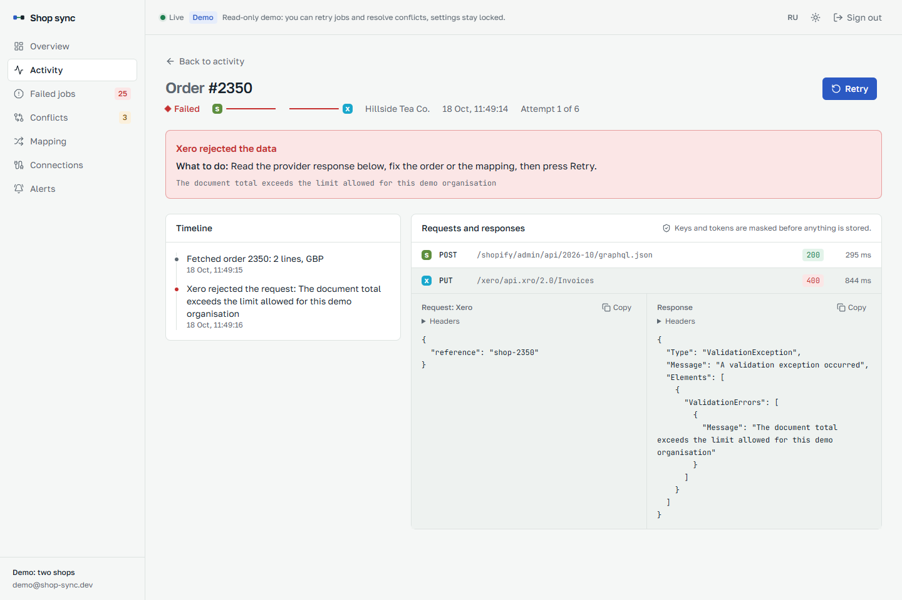
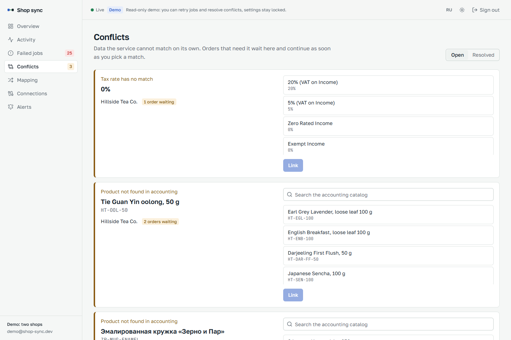
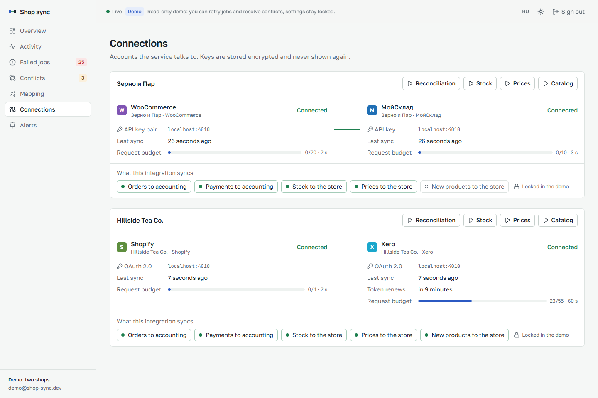
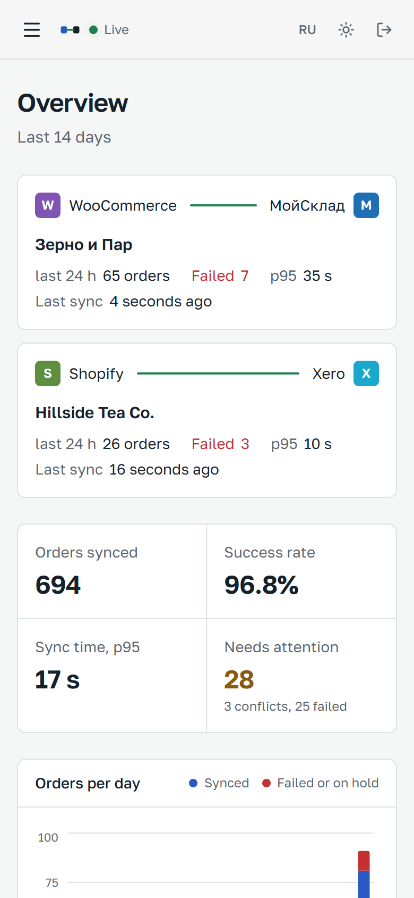
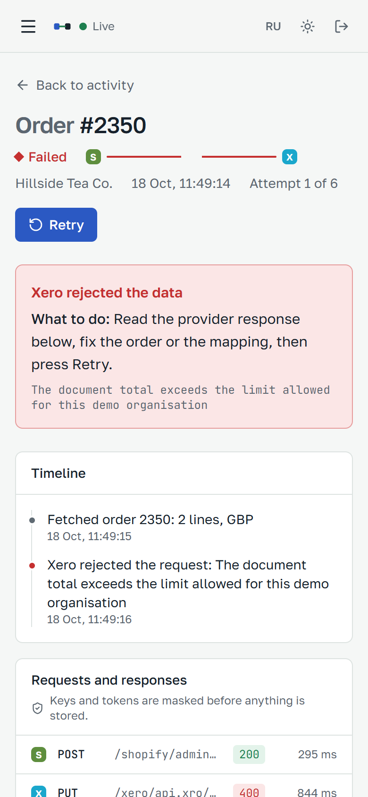
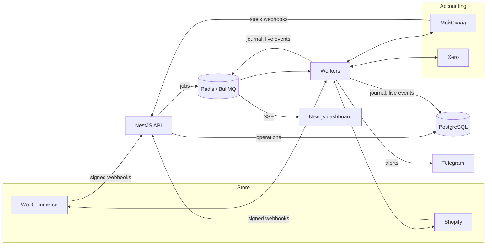

# Shop ↔ accounting sync

An integration service that connects an online store to an accounting and inventory system. Orders from WooCommerce and Shopify become documents in МойСклад and Xero, payments are recorded against them, and stock levels and prices flow back to the store. Every step is logged with its request and response, failures explain themselves in plain words, and anything can be retried with one click.



## Why it exists

Shops usually glue these systems together with Zapier, Make or a marketplace plugin, and the same complaints come up again and again: duplicate invoices, syncs that quietly stop after a few webhook failures, errors nobody can read, and a SKU that does not match failing the whole order. This project is built around those failure modes:

| Problem | What the service does |
| --- | --- |
| Duplicate orders and payments | Webhook deliveries are deduplicated by provider delivery id, every operation has a dedupe key, and the accounting side is checked for a document with our reference before anything is created. Xero writes carry an `Idempotency-Key`. |
| Webhooks silently stop | A reconciliation job lists recently changed orders and queues whatever the webhooks missed. |
| Opaque errors | Each failure has a code, a plain-language explanation with what to do next, and the masked HTTP exchange that caused it. |
| One unknown SKU breaks everything | The order is put on hold behind a *conflict*. Pick the matching product once and every waiting order continues by itself. A later catalog refresh closes conflicts that now match. |
| Rate limits and bans | A Redis limiter keeps each connection under its provider budget (МойСклад now bans accounts that keep hitting 429). Provider `Retry-After` parks the job without spending a retry attempt. |
| Flaky provider | Exponential backoff with jitter, then a dead-letter queue and a Telegram alert. |

## Try it

You need Docker. The stack starts with a sandbox that emulates all four provider APIs and keeps placing orders, so the dashboard has real traffic to show without any provider accounts.

```bash
cp .env.example .env   # then fill ENCRYPTION_KEY and SESSION_SECRET (openssl rand -base64 32)
docker compose up --build
```

Open <http://localhost:3000> and press **Open the live demo**. The demo account is read-only for settings and credentials but may retry jobs, resolve conflicts and run a sync now. The sandbox status page is at <http://localhost:4010>.

What you will see within a few minutes: new orders arriving in the activity log, payments following them, a rate-limited call retried by itself, an order with an unknown SKU waiting on the Conflicts page, and an occasional order that Xero rejects landing in Failed jobs.

## Screens

| | |
| --- | --- |
|  |  |
|  |  |

<p>
  
  
</p>

The dashboard has light and dark themes and English and Russian texts.

## What syncs

| Flow | Trigger | Store → accounting |
| --- | --- | --- |
| Order → sales document | order webhook, reconciliation | customer (matched only by our own key), lines with discounts and VAT, shipping, status, warehouse |
| Payment → incoming payment | paid webhook, after the order | linked to the order document |
| Stock → store | МойСклад stock webhook, every 10 min | only changed items, batched, untracked items left alone |
| Prices → store | price change webhook, hourly | only changed items |
| New products → store | every 6 h, per integration flag | created as drafts in the store |
| Catalog refresh | product webhook, every 6 h | auto-links products by SKU, then barcode |

## Architecture

A NestJS API receives webhooks, verifies their signatures, records the delivery and turns each event into an **operation**: a row in PostgreSQL with a dedupe key, plus a BullMQ job in Redis. Workers (the same image with `APP_ROLE=worker`) claim the operation atomically, run the flow through the connectors and write every HTTP exchange to the journal with secrets masked. Results, errors and retries are pushed to the dashboard over Server-Sent Events through Redis pub/sub. Provider tokens are encrypted with AES-256-GCM at rest.

Connectors implement one of two interfaces, `StoreConnector` or `AccountingConnector`, on top of a shared HTTP client that knows nothing about the provider except its error policy. Adding 1С or Bitrix24 means writing one class and registering it in `connectors/registry.ts`; the queues, retries, journal and dashboard work unchanged.



### Stack

| | |
| --- | --- |
| API and workers | Node.js 22, NestJS 12, BullMQ 6, Prisma 7, PostgreSQL 17, Redis 7, Zod |
| Dashboard | Next.js 16 (App Router, server components), React 19, Tailwind CSS 4, Recharts |
| Sandbox | Hono, in-memory emulation of WooCommerce REST v3, Shopify Admin GraphQL 2026-10, МойСклад JSON API 1.2, Xero Accounting API |
| Quality | TypeScript strict, Biome, Vitest, msw contract tests, GitHub Actions |

## Connectors

| Provider | API | Auth | Webhook check | Notes |
| --- | --- | --- | --- | --- |
| WooCommerce | REST v3 | consumer key and secret | `X-WC-Webhook-Signature`, HMAC-SHA256 | batch endpoints, variations, `date_paid` decides "paid" |
| Shopify | Admin GraphQL 2026-10 | access token | `X-Shopify-Hmac-Sha256`, dedupe on `X-Shopify-Webhook-Id` | `inventorySetQuantities` with `@idempotent`, cost-based throttling |
| МойСклад | JSON API 1.2 | bearer token | secret in the delivery URL (the API does not sign), dedupe on `requestId` | prices in kopecks, orders upserted by `externalCode` |
| Xero | Accounting API | OAuth 2.0 with refresh | `x-xero-signature`, intent to receive | rotated refresh tokens stored back, tax types from `/TaxRates` |

## Local development

```bash
npm install                                  # also builds the shared packages
docker compose up -d postgres redis
npm run -w @sas/api db:migrate && npm run -w @sas/api db:seed
npm run dev                                  # sandbox :4010, API and worker :4000, dashboard :3000
```

The seed creates an owner account and prints its password unless `SEED_OWNER_PASSWORD` is set.

### Tests

```bash
npm test                                     # unit and contract tests
INTEGRATION=1 npx -w @sas/api vitest run test/integration   # needs Postgres and Redis
```

- Connector contract tests replay realistic provider payloads through msw and check the exact requests each connector sends.
- Sandbox tests drive the real connector classes against the emulator.
- The integration test sends a signed webhook to a running API and waits for the order and its payment to appear in the emulated МойСклад, checks that a repeated delivery is dropped and that an unknown SKU ends on a conflict.

## Configuration

| Variable | Purpose |
| --- | --- |
| `DATABASE_URL`, `REDIS_URL` | storage |
| `ENCRYPTION_KEY` | 32 random bytes in base64, encrypts provider credentials |
| `SESSION_SECRET` | signs dashboard sessions |
| `APP_ROLE` | `api`, `worker` or `all` |
| `QUEUE_PREFIX` | keeps several deployments apart on one Redis |
| `DEMO_ENABLED`, `DEMO_ALLOW_ACTIONS` | the public demo login and what it may do |
| `TELEGRAM_BOT_TOKEN`, `TELEGRAM_CHAT_ID` | alerts; without them alerts are only logged |
| `SANDBOX_*`, `DEMO_GENERATOR` | the emulator and its order generator |

## Roadmap

- 1С through the CommerceML exchange, for shops whose books live in 1С:Бухгалтерия or 1С:УНФ
- Bitrix24 and amoCRM as order destinations for teams that run sales in a CRM
- OAuth connect buttons for Xero and Shopify in the dashboard (the token refresh is already in place)
- Refunds and credit notes, partial payments
- Per-integration Telegram chats and quiet hours

## Project layout

```
apps/
  api/        NestJS: webhooks, sync engine, connectors, dashboard API
  web/        Next.js dashboard
  sandbox/    emulator of the four provider APIs plus the demo order generator
packages/
  shared/     types and error texts shared by API and dashboard
  demo-data/  fictional shops, products and customers
```
